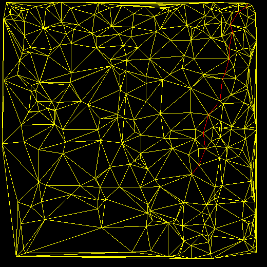

# delaunay-dijkstra-astar

[](https://github.com/Wil12Fred/delaunay-dijkstra-astar/actions/workflows/ci.yml) [](LICENSE)

Delaunay road map, Dijkstra and A* in one small C++ program: it triangulates a cloud of
points into a "street" graph and finds shortest paths on it with Dijkstra, or finds a path
across a grid full of obstacles with A*.



## Features

- **Delaunay triangulation** by lifting the points onto a paraboloid and keeping the lower
  faces (brute force, O(n⁴)).
- **Dijkstra** on the triangulation, with Euclidean edge weights, behind a small Strategy
  pattern; the triangulation is drawn in yellow and the path in red with OpenGL/GLUT.
- **A\*** on a 100×100 grid with random water, building and fire obstacles, 8-connected,
  with configurable straight and diagonal step costs; the map is printed with ANSI colours.

## Requirements

| | Debian / Ubuntu | Arch Linux |
|---|---|---|
| compiler, make | `g++ make` | `gcc make` |
| OpenGL / GLUT | `freeglut3-dev` | `freeglut` (pulls in `mesa`, `glu`) |
| tests only | `xvfb imagemagick` | `xorg-server-xvfb imagemagick` |

On macOS the system GLUT/OpenGL frameworks are used.

## Build

```sh
make          # builds Prueba/main and Prueba/trans
```

The Xcode project `Prueba.xcodeproj` is kept for reference only. It points at a `main.cpp`
that is not in the repository, so use the Makefile.

## Run

Run from `Prueba/`: the input files are read by relative path, and the program writes
`aristas.txt` (edges), `camino.txt` (path), `comprobar1.txt` and `comprobar2.txt` (edge
lists) into the current directory on every start. They are not tracked.

**OpenGL mode** — node count, mode `2`, then start and end node:

```sh
cd Prueba
printf '300\n2\n0 4\n' | ./main
```

```
Cantidad de nodos: Elija opcion
...
78.1025
736.935                                    <- path length
4 20 219 222 107 171 180 135 280 14 69 252 202 211 0
CAMINO:

746 328
...
965 994
```

The arrow keys pan the view and F1/F2 zoom. Esc quits.

**Terminal (A\*) mode** — node count (ignored), mode `1`, start `row col`, goal `row col`,
then the cost of a straight step and of a diagonal step:

```sh
printf '300\n1\n0 0\n5 7\n1 1.4\n' | ./main
```

```
Cantidad de nodos: Elija opcion
1=terminal
2=Opengl
Ingrese los puntos de inicio y de llegada
Ingrese los obstaculos
(0,0)
(0,1)
(0,2)
(1,3)
...
(5,7)
***          B F  F           A   A     ...
```

It prints the path as `(row,col)` lines, then the map: `A` water, `B` building, `F` fire,
`T` the goal and `*` the path. The obstacles are random on every run.

`trans` rebuilds `coord.txt` from the last N points of `coord3.txt`:

```sh
echo 300 | ./trans
```

## Tests

```sh
make test
```

- `Prueba/tests/test_algorithms.cc` — unit tests; `main.cc` is included with its `main`
  renamed, so the classes are tested as they are. Delaunay: a convex quadrilateral gives
  the two triangles on the right diagonal; for random points every triangle has an empty
  circumcircle and there are 2n − 2 − h of them. Dijkstra: picks a two-edge detour over a
  longer direct route and returns the exact length; reports an unreachable node.
  A\*: goes straight down the diagonal on an empty board; goes round a wall without
  touching it; writes the map as 100 rows of 100 cells with the wall, path and goal in the
  right places. It runs in `Prueba/tests/run/`, since the program's globals write files.
- `Prueba/tests/run_program.sh` — runs the real binary in a scratch directory. OpenGL
  mode on the committed `coord.txt` must print exactly `tests/expected/opengl_300_0_4.txt`
  (points, triangles, weights, Dijkstra length 736.935 and path), and a screenshot of its
  window, always on a private `xvfb-run` display, must show the yellow triangulation and
  the red path. A\* mode must end its path at the goal and print a 100×100 map.

## Project layout

| File | Contents |
|---|---|
| `Prueba/main.cc` | entry point, Dijkstra (Strategy pattern), GLUT drawing |
| `Prueba/delaunay.h` | Delaunay triangulation (lifting to a paraboloid) |
| `Prueba/grafo.h` | `Nodo`, `Arista`, `Grafo` → adjacency list |
| `Prueba/aest.h` | A\* on a grid with random obstacles |
| `Prueba/Trans.cpp` | point-file converter |
| `Prueba/coord*.txt` | input points |
| `Prueba/tests/` | unit tests, the program run, the expected output |

## Known limitations

- The A\* heuristic is `|Δrow + Δcol|` rather than a distance, so paths are valid but not
  always the shortest; with random obstacles the start or goal can itself be an obstacle,
  and then the "path" is just the goal. Open/closed sets are vectors searched linearly.
- The random A\* map uses `srand(time(NULL))`, so terminal runs cannot be reproduced.
- Delaunay is O(n⁴) and assumes general position (no four cocircular points).
- The `Algorithm2` strategy is an empty placeholder.
- Fixed in this pass (each with a test): A\* wrote the map half with `printf` and half with
  `cout` after `sync_with_stdio(false)`, so cells and colour codes came out in different
  places; the Delaunay self-check rejected valid triangles through floating-point rounding
  on non-integer coordinates; and the OpenGL window stayed black in a directory without an
  `aristas.txt`, because the file was opened for reading before it was created. The
  arrow/F-key handler also printed every value on every key (missing braces).

## Background

A university exercise in graph algorithms, written in 2016 and updated in 2018 on macOS
with Xcode; ported to build on Linux.

## License

MIT — see [LICENSE](LICENSE).
